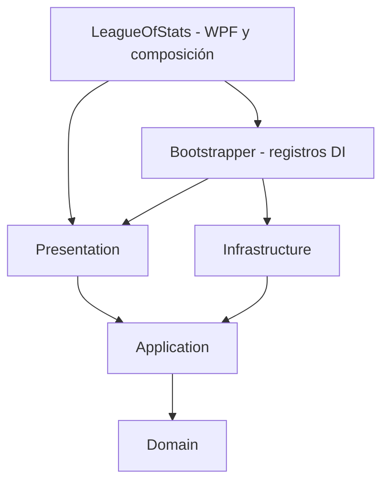

# Arquitectura DDD y SOLID

Solución: `LeagueOfStats.sln`, .NET 10. Un tipo público por archivo.

## Dependencias



`Presentation` es una biblioteca net10.0 sin referencias a WPF, SQLite ni Infrastructure. WPF contiene vistas y el punto de composición en `App`. App construye el contenedor DI y espera su liberación asíncrona antes de terminar WPF. Los registros de servicios residen en Bootstrapper.

## Responsabilidades

| Componente | Responsabilidad |
| --- | --- |
| Domain/Catalog | Valores, entidades y agregado inmutable de catálogo |
| Domain/Matches | Muestras y proyección del jugador activo y su equipo |
| Domain/Synchronization | Política de calendario; `ISyncSchedule` y `FortnightlySchedule` |
| Application/MonitorMatch | Capturar y persistir muestras; asignar sesión local |
| Application/RefreshCatalog | Comparar versiones y reemplazar el catálogo |
| Application/RefreshPatchNotes | Leer y persistir enlaces oficiales |
| Application/ScheduledSync | Aplicar calendario, serializar revisiones y registrar intentos/éxitos |
| Presentation/LiveMonitorViewModel | Estado visible del jugador/equipo y ciclo de consultas |
| Presentation/SynchronizationViewModel | Estado y tareas de un flujo de sincronización; reutilizado para catálogo y notas |
| Presentation/MonitorViewModel | Coordinar inicio y cierre de los tres flujos |
| Infrastructure/SqliteDatabase | Ubicación y cadena de conexión |
| Infrastructure/DatabaseInitializer | Migraciones y retención al iniciar |
| Infrastructure/SqliteSampleRepository | Escritura de muestras propias |
| Infrastructure/SqliteCatalogRepository | Lectura y reemplazo atómico de catálogos |
| Infrastructure/SqliteSyncStateStore | Ancla y estados de sincronización |
| Infrastructure/SqlitePatchNotesRepository | Enlaces de notas oficiales |

## Aplicación de SOLID

- **S — Responsabilidad única:** se eliminaron el repositorio multipropósito `SqliteStore` y el ViewModel que reunía todos los estados. La inicialización, muestras, catálogos, monitoreo y sincronización tienen componentes separados.
- **O — Abierto a extensión:** `ScheduledSync` depende de `ISyncSchedule`. Se puede sustituir la política de fechas sin modificar el ejecutor. `SynchronizationViewModel` funciona con cualquier `IScheduledSync`.
- **L — Sustitución:** las pruebas utilizan implementaciones alternativas de `IMatchMonitor`, `IScheduledSync` e `IApplicationInitializer` para verificar resultados, cancelación y cierre. Los contratos asíncronos preservan la cancelación solicitada; no se simula éxito cuando se cancela una operación.
- **I — Interfaces específicas:** `IRiotCatalogClient` expone únicamente la lectura regional y descarga que necesita la sincronización. La consulta de versiones disponibles está en `IPatchVersionSource`. Muestras, catálogos y notas tienen contratos de repositorio distintos.
- **D — Inversión de dependencias:** los ViewModels reciben contratos de Application; Application recibe contratos de repositorio y fuentes. Las implementaciones HTTP/SQLite se conectan en `App`.

La herencia se limita a `ObservableViewModel` para notificaciones de propiedades. La lógica se compone mediante dependencias; no se introdujeron repositorios genéricos ni jerarquías de servicios.

## Ciclo de vida

`MonitorViewModel.Start` inicializa la base una sola vez y arranca los hijos. `DisposeAsync` cancela y espera tanto los bucles como las revisiones manuales; llamadas repetidas esperan la misma tarea de cierre. Los trabajos SQLite se ejecutan fuera del hilo de WPF; las actualizaciones de propiedades regresan al contexto de presentación.

`LiveMonitorViewModel` consulta cada dos segundos durante una partida y espera quince segundos cuando la API no está disponible o hay un error. Limpia la información visible para no mostrar una partida anterior.

Cada `SynchronizationViewModel` agrupa solicitudes simultáneas del mismo flujo en una tarea. La política mantiene miércoles/jueves de semanas alternas, con ancla y estados persistidos. Los dos flujos continúan siendo independientes.

## Proyección Live Client

`LiveTeamParser` filtra rivales antes de construir `ActiveTeamSnapshot`. Solo el jugador activo y aliados llegan a `TeamPlayerRow`. SQLite persiste la captura propia y eventos normalizados; la proyección con nombres del equipo permanece en memoria. Las vistas enlazan `Live.Status`, `Live.Stats`, `Live.ActivePlayer`, `Live.TeamPlayers`, `Catalog.Status` y `Notes.Status`.

## Verificación

```powershell
dotnet build LeagueOfStats.sln -c Release
dotnet run --project tests/Smoke -c Release
```

Las pruebas cubren migraciones, rollback, aislamiento por idioma, datos de Riot, exclusión de rivales, calendario, estado persistido, sustitución de dependencias, limpieza de datos, agrupación de revisiones y cierre durante inicialización/operaciones activas. También verifican que Presentation no referencia Infrastructure, SQLite ni WPF.

`Smoke` es un ejecutable de comprobaciones; no se descubre mediante `dotnet test`. OverlaySmoke comprueba estilos y posicionamiento en ventanas nativas de prueba. No se ha probado el overlay en una partida real.

Las versiones de paquetes se centralizan en `Directory.Packages.props`; la configuración de compilación está en `Directory.Build.props` y el formato en `.editorconfig`.

## Contenedor de inyección de dependencias

`LeagueOfStats.Bootstrapper` utiliza `Microsoft.Extensions.DependencyInjection`. `AddLeagueOfStats` registra contratos, implementaciones HTTP/SQLite, casos de uso y ViewModels. `App` agrega las ventanas, construye `ServiceProvider` con `ValidateOnBuild` y `ValidateScopes`, y resuelve `MainWindow`.

Los servicios son singleton para una única sesión de escritorio. Los repositorios crean conexiones por operación; no comparten una conexión SQLite abierta. `IScheduledSync` y `SynchronizationViewModel` tienen registros keyed `catalog` y `notes` para conservar estados independientes. Las interfaces de Data Dragon apuntan a una misma instancia. Los clientes HTTP se registran mediante factories para que el contenedor sea su propietario.

No se inyecta `IServiceProvider` en los casos de uso ni en ViewModels. Solo el código de composición resuelve registros. Domain, Application y Presentation permanecen independientes de la biblioteca DI.

WPF usa `OnExplicitShutdown`: la ventana espera la finalización del ViewModel, luego App espera `ServiceProvider.DisposeAsync()` y finalmente ejecuta `Shutdown`. Esto evita liberar clientes mientras quedan operaciones pendientes y permite servicios que solo implementan `IAsyncDisposable`. También se libera el contenedor si falla el inicio.

`DependencyInjectionChecks` resuelve el grafo completo sin abrir ventanas, verifica claves y singletons, inicializa una base temporal y comprueba la liberación de ambos clientes HTTP.

`WindowsOverlayHost` está registrado mediante DI en WPF y limita las operaciones nativas a metadatos de ventanas y al HWND del propio overlay. La lógica de datos sigue independiente del mecanismo de superposición. Ver [overlay](overlay.md).


## Capturas recuperables y revisión posterior

`ISampleRepository.RecordAsync` realiza en una transacción la recuperación o creación de sesión, los eventos deduplicados, las muestras y la transición final. `MonitorMatch` serializa las operaciones y registra fallos. `IReviewRepository` separa las consultas del historial de la escritura de capturas; `CreateMatchReview` calcula la comparación y construye un paquete versionado. `ReviewViewModel` agrupa operaciones manuales y participa del cierre coordinado. La capa WPF solo selecciona el archivo de exportación.

`FileDiagnostics` implementa el puerto `IAppDiagnostics` con registros JSONL locales acotados. `ReviewMaintenance` conserva las referencias comparables y elimina hijos mediante FK. El mutex de escritorio evita dos instancias del monitor. Ver [diseño y límites de la revisión](postgame-review.md).
