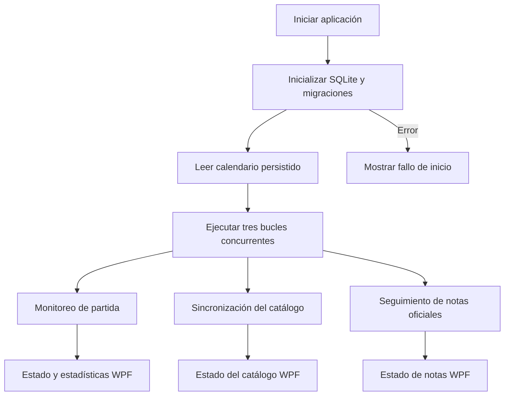
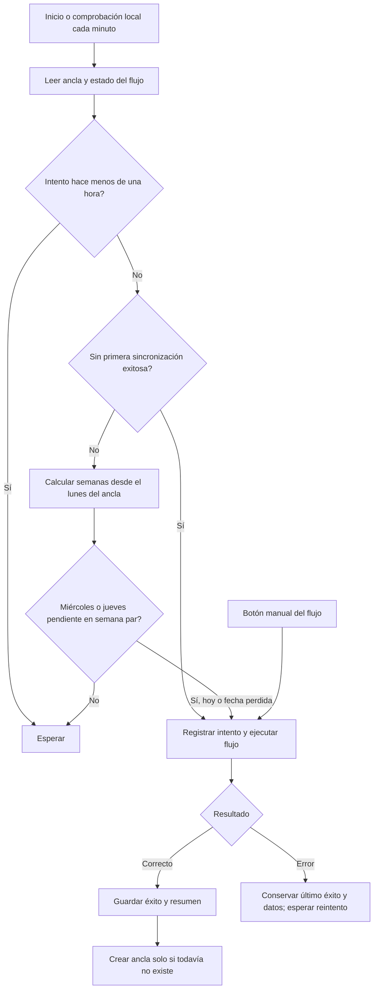
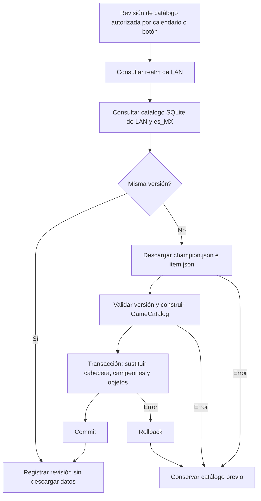
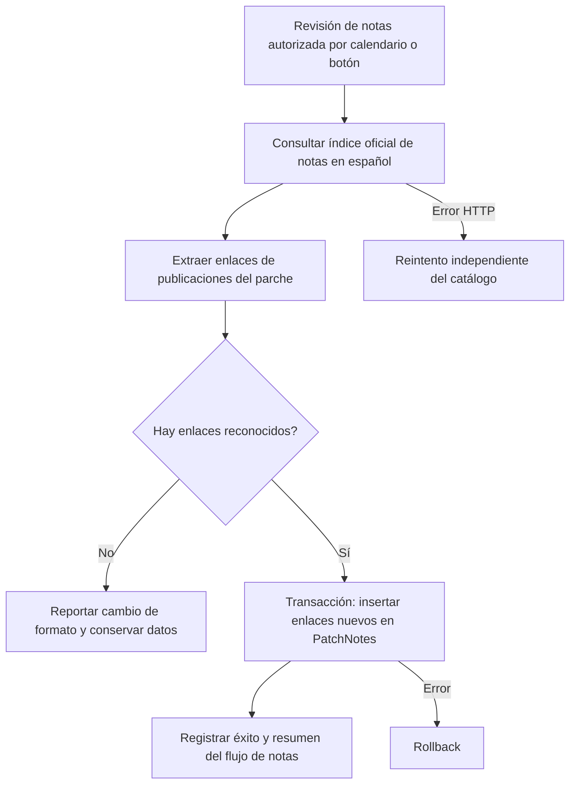
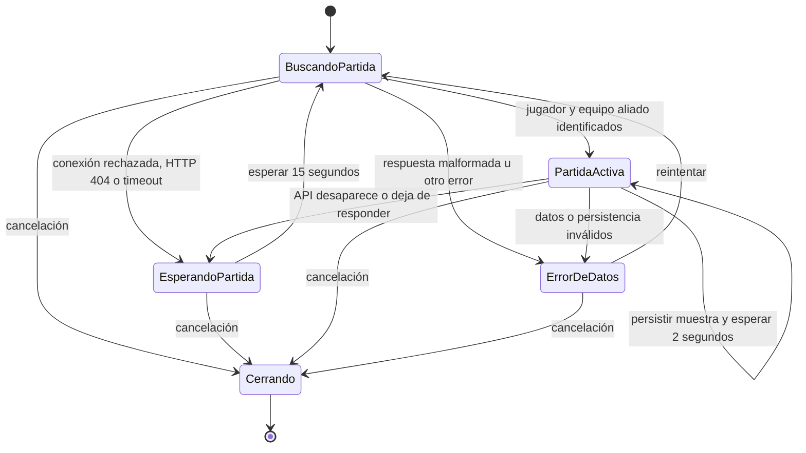
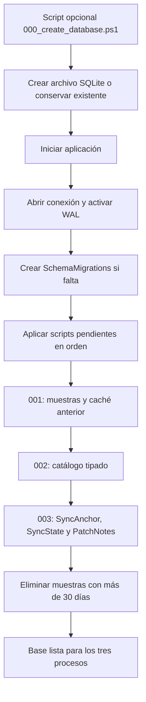
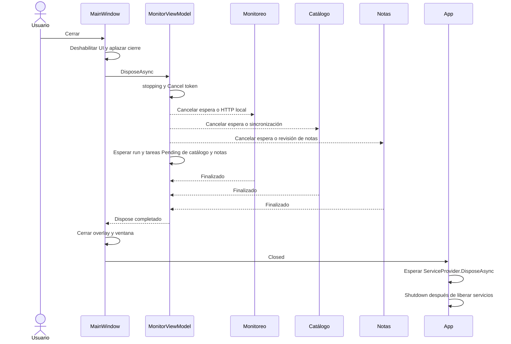
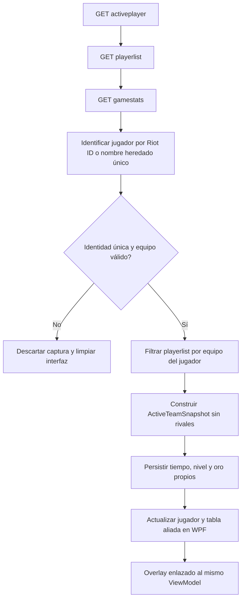

# Flujos y ciclo de vida

Diagramas Mermaid del comportamiento implementado. Hay tres procesos independientes: catálogo Data Dragon, seguimiento de notas oficiales y monitoreo de la API local. La disponibilidad de una partida no controla las sincronizaciones externas.

## 1. Inicio y procesos independientes

## 2. Calendario de revisiones

- Primera sincronización: inmediata, independientemente del día. El primer éxito de cualquiera de los flujos fija un ancla común en SQLite.
- La semana del ancla es la **semana 0**, de lunes a domingo, en `America/Mexico_City`.
- Revisiones: miércoles y jueves en semanas **0, 2, 4, 6...**, una revisión exitosa por día y por flujo. La primera sincronización ya cuenta como revisión de ese día.
- Ejemplo con primera sincronización el martes 3 de noviembre de 2026: revisiones el 4 y 5; se omiten el 11 y 12; se revisa el 18 y 19.
- Cada flujo conserva su último intento, último éxito y resumen. Reiniciar no cambia el ancla ni repite una revisión completada.
- Si la aplicación estuvo cerrada, al abrir recupera la revisión pendiente más reciente, incluso fuera de miércoles/jueves. No reproduce cada fecha perdida.
- Si falla, reintenta como máximo una vez por hora, incluida la primera sincronización. No marca éxito ni borra los datos anteriores.
- Los botones manuales fuerzan únicamente el flujo seleccionado y no cambian el ancla.
- Cada minuto se evalúa el calendario **localmente**; esto no implica una petición a Riot cada minuto. La aplicación debe estar abierta para ejecutar tareas; no se instaló un servicio ni una tarea de Windows.

## 3. Catálogo de objetos y campeones

`RefreshCatalog` usa Data Dragon y actualiza objetos y campeones juntos para conservar una versión coherente. Un éxito sin cambio de versión cuenta como revisión. Si Riot publica el catálogo después de la ventana prevista, se detectará en la siguiente revisión programada o manual. Las notas publicadas no fuerzan ni sustituyen una versión del catálogo.

## 4. Notas del parche

Fuente: https://www.leagueoflegends.com/es-mx/news/tags/patch-notes/ . Es un adaptador del sitio oficial, no una API JSON documentada de Riot. Persiste URL y fecha de descubrimiento. No descarga el cuerpo de cada artículo, no detecta ediciones dentro del mismo artículo y no genera estrategias automáticamente. El adaptador falla explícitamente si el índice deja de contener enlaces reconocibles.

## 5. API local: espera, partida y desconexión

No se requiere que el cliente local esté abierto para iniciar la aplicación. Mientras no haya datos válidos, no se guardan muestras ni se muestran estadísticas antiguas. Una desconexión no demuestra que la partida terminó: puede ser transitoria. Las sesiones pasan por Capturing, Disconnected e Interrupted; solo GameEnd las marca Completed. La recuperación consulta el estado persistido y la compatibilidad temporal. Ver postgame-review.md para las condiciones exactas. Los intervalos se suman al tiempo empleado por las solicitudes y la escritura. El overlay comparte la proyección filtrada del jugador y aliados con la ventana principal; se limpia al perder la conexión.

## 6. Base de datos

Cada migración tiene su propia transacción y registro; las migraciones ya aplicadas se omiten. Las sincronizaciones y sus estados son reintentables: si se guardan datos pero falla el registro de éxito, el siguiente intento vuelve a comprobar la fuente sin duplicar notas.

## 7. Cierre coordinado

Un fallo de catálogo no detiene notas ni monitoreo. Un fallo de notas tampoco detiene los demás procesos. Los trabajos manuales de cada flujo comparten su tarea en curso para evitar descargas simultáneas del mismo flujo dentro de la aplicación.

## 8. Proyección del jugador y equipo aliado

## Componentes responsables

`MonitorViewModel` coordina el ciclo de vida. `LiveMonitorViewModel` ejecuta el monitoreo y dos instancias de `SynchronizationViewModel` ejecutan catálogo y notas. Todos están en el proyecto Presentation, sin dependencia de WPF o SQLite. Véase [arquitectura SOLID](architecture.md).

La revisión posterior, exportación y estados recuperables se documentan en [flujo de revisión](postgame-review.md).

