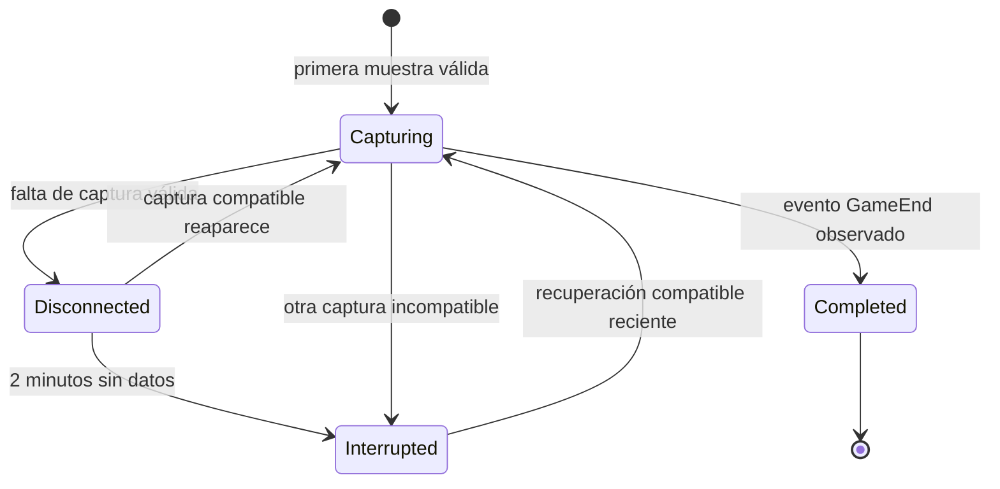

# Revisión posterior a la partida

## Uso

1. Mantén LeagueOfStats abierto mientras juegas. La captura utiliza únicamente endpoints documentados del Live Client.
2. Al terminar, abre **Revisión posterior a la partida → Actualizar historial**.
3. Selecciona la captura y pulsa **Generar resumen y comparación**.
4. **Exportar para IA…** guarda un `.txt` con instrucciones en español y datos JSON. Adjunta ese archivo a la IA que elijas.

La generación es local: no requiere clave ni envía información a un proveedor de IA. El resumen calculado y el paquete se guardan en SQLite; la respuesta del proveedor se obtiene al entregarle el archivo. El overlay no muestra este análisis.

## Tablas y datos

| Tabla | Contenido | Cuándo se escribe |
|---|---|---|
| `MatchSessions` | Modo, mapa, campeón, rol, tiempos, estado de captura, resultado observado, indicadores de calidad y `ReviewJson` | Durante la captura; `ReviewJson` al generar el resumen |
| `MatchSamples` | Tiempo de juego, nivel, oro disponible, K/D/A, CS, ward score si existe, estado de muerte, vida e IDs/cantidades de objetos propios | Cada 10 segundos de juego o ante cambios de K/D/A y cierre |
| `MatchEvents` | Eventos seleccionados, tiempo, ID, participación propia cuando coincide exactamente y resultado de `GameEnd` | Durante la captura, deduplicados por sesión/ID |
| `Samples` | Muestras básicas del prototipo anterior | Histórica; ya no recibe nuevas escrituras |
| `LocalSettings` | Sal aleatoria para crear una clave seudónima del jugador | Inicialización |
| `SchemaMigrations` | Migraciones aplicadas | Inicialización |

Los datos capturados en vivo se conservan en las mismas tablas para su revisión posterior. No se duplican en una segunda copia al terminar. La proyección con nombres de aliados sigue exclusivamente en memoria. La nueva migración elimina el JSON original de eventos históricos y mantiene sus ID, tipo y tiempo; esos eventos antiguos sin campos validados no se exportan.

La clave del jugador es un HMAC del identificador con una sal local. Permite separar cuentas, pero no se exporta. Es seudonimización, no cifrado de la base. SQLite y los archivos exportados dependen de los permisos de la cuenta de Windows; el archivo de exportación se guarda donde el usuario indique.

## Qué significa “las últimas 10”

Son hasta diez partidas **anteriores a la captura seleccionada**, del mismo jugador, `gameMode` y `mapNumber`. La partida seleccionada no está incluida en su propia referencia. Se exigen `GameEnd`, captura iniciada antes del segundo 60, al menos cinco minutos de duración, ausencia de huecos detectados y disponibilidad final de eventos. Si hay menos de diez se muestra la cantidad real. Las capturas interrumpidas, antiguas sin metadatos o incompletas no entran en esta referencia.

`CLASSIC / mapa 11` y `ARAM / mapa 12` se separan. **El Live Client no proporciona aquí la cola exacta normal, solo/duo o flex:** el paquete declara `QueueId: null`. No se infiere clasificatoria por el modo. Tampoco se atribuye al match la versión regional de Data Dragon, que puede diferir del parche real.

Se calculan CS/minuto y muertes por diez minutos, sus medias previas y la cantidad de referencias del mismo rol. El paquete también incluye resultados conocidos, campeón, rol, muestras y eventos para interpretación posterior. Los roles o campeones distintos pueden sesgar una comparación: el prompt lo advierte. Oro disponible no es oro ganado; ward score no es un mapa de visión.

## Recuperación y consistencia

La recuperación consulta SQLite y compara jugador, modo, mapa, campeón y progresión del reloj; admite una interrupción menor a diez minutos y una diferencia de hasta 90 segundos entre reloj real y de juego. Es una heurística: estos endpoints no aportan un match ID oficial. Pausas largas, cambio del reloj del sistema o reinicios prolongados pueden producir capturas separadas. Los huecos mayores a 30 segundos se marcan; nunca se inventa una victoria ni se declara finalizada una partida únicamente por perder conexión.

Al reiniciar, una captura abandonada se marca `Interrupted`; puede reanudarse si aún cumple los criterios. Un cierre abrupto conserva lo ya confirmado por SQLite. Si no se observa `GameEnd` antes de desaparecer la API, solo puede exportarse una revisión incompleta y queda fuera de la comparación. El historial muestra hasta 100 capturas recientes.

Las transacciones incluyen cambio de sesión, muestras, eventos y metadatos. Se usa WAL, claves foráneas y reintentos acotados para `SQLITE_BUSY`/`LOCKED`. El monitor serializa captura y notificación de desconexión. Un mutex impide dos instancias de la aplicación en la misma sesión de Windows. La lectura del resumen usa una transacción consistente; al guardarlo comprueba que la captura no se haya reanudado o cambiado.

La indisponibilidad de `eventdata` no descarta las métricas propias; se registra y se reintenta en el próximo ciclo. Como ese endpoint devuelve el historial acumulado, una lectura posterior válida recupera eventos omitidos. Las respuestas de endpoints distintos no constituyen un snapshot atómico del juego.

## Privacidad y límites del análisis

Se permiten exclusivamente `GameStart`, `GameEnd`, eventos de objetivos y eliminaciones en las que se identifica exactamente al jugador activo como autor, víctima o asistente. Solo pasan campos normalizados; los nombres de los demás participantes, campos desconocidos y JSON original se descartan. Los eventos de objetivos no se convierten en atribución de equipo, rutas ni resultados de peleas.

No hay posiciones, oleadas, visión espacial, campamentos, temporizadores enemigos, resultados deducidos de team fights ni datos de memoria del juego. El prompt exige citar evidencia con tiempo, separar hipótesis y solicitar replay cuando falte contexto. Las métricas no prueban por sí solas que una decisión fue correcta, y no se diagnostica estado emocional ni se recomienda seguir jugando basándose en resultados.

Estas restricciones técnicas no sustituyen la revisión y registro del producto por Riot. Referencias: https://developer.riotgames.com/docs/lol y https://developer.riotgames.com/policies/general.

## Operación

- DB: `%LOCALAPPDATA%\LeagueOfStats\leagueofstats.db`.
- Registros: `%LOCALAPPDATA%\LeagueOfStats\logs\operations-AAAA-MM-DD.jsonl`, máximo 5 MiB por archivo y retención de 14 días. Incluyen código, contador acumulado, ID local de sesión y tipo de error; no payloads ni mensajes de excepción. Eventos repetidos se agrupan durante 30 segundos. Un fallo del registro no detiene la captura.
- Retención: limpieza al iniciar y al observar `GameEnd`; 30 días para `Samples`, 90 días para capturas cerradas, preservando las diez comparables más recientes por jugador/modo/mapa incluso si son más antiguas. Los hijos se eliminan en cascada. No se borran capturas activas.
- Respaldo manual: cierra LeagueOfStats y copia la base junto con los archivos `-wal`/`-shm` que todavía existan. No copies un archivo SQLite abierto aisladamente. Para restaurar, cierra la app y repón el conjunto respaldado.
- No se envían registros ni datos a servicios externos automáticamente. Las exportaciones manuales no están cubiertas por la retención interna.

`tests/Smoke/ReviewChecks.cs` verifica recuperación, transacciones, duplicados, concurrencia, privacidad, fallo del endpoint opcional, comparación por tipo, exportación y retención. Los datos de prueba son sintéticos; sigue pendiente validar un ciclo completo con una partida real.

## Tarjeta «Última partida»

MainWindow muestra la captura cerrada más reciente, con campeón, resultado, fecha CDMX, modo/mapa, rol, duración, K/D/A, CS/min, nivel, oro disponible, ward score y objetos de la última muestra. Se actualiza desde SQLite cada 30 segundos; una captura interrumpida se etiqueta como incompleta.

El catálogo local de Data Dragon resuelve nombres y URLs de retratos e iconos. DataDragonImageCache descarga las imágenes del CDN oficial y las guarda en %LOCALAPPDATA%\LeagueOfStats\cache\images\<versión>\champion o item. WPF carga los PNG locales; después de la primera descarga funcionan sin conexión. Un catálogo ausente, un objeto desconocido o una descarga fallida no impide mostrar las estadísticas. Las imágenes usan la versión del catálogo local, sin afirmar que sea el parche de la partida.

La migración `006_champion_identity.sql` agrega `MatchSessions.ChampionId`. El adaptador obtiene ese identificador de `rawChampionName`, para resolver retratos independientemente del idioma. Para capturas anteriores se intenta resolver por nombre o ID conocidos del catálogo.

La caché restringe origen, ruta, tamaño y cabecera PNG; escribe primero en un archivo temporal y lo publica de forma atómica. Comparte descargas concurrentes del mismo recurso, permite hasta tres descargas distintas a la vez y reintenta fallos después de un minuto. La tarjeta muestra cuántas imágenes están disponibles. No requiere API key.

El catálogo oficial puede contener objetos cuyo nombre localizado sea vacío. El adaptador utiliza «Objeto #ID» para conservar su identidad e imagen; esos registros ya no impiden sincronizar el resto del catálogo.
